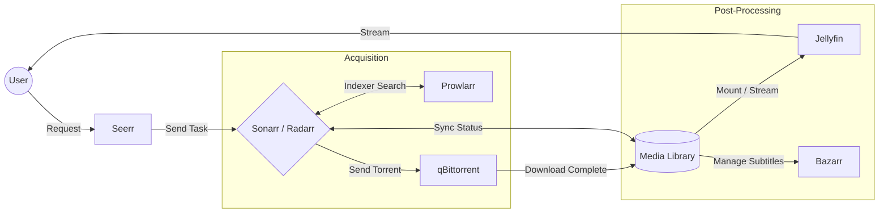

---

title: How to Build a Personal Media Library
published: 2026-01-21
updated: 2026-07-30
description: 'A complete walkthrough of building a self-hosted personal media library with the *Arr stack and Jellyfin, along with practical configuration tips'
image: ''
tags: ["NAS", "AIO", "Jellyfin", "Docker", "Arr"]
category: 'Media & Entertainment'
draft: false
lang: 'en'
---

## Background

Everything started in March 2023 after the Chia mining crash, when used enterprise hard drives flooded the market at bargain prices. I picked up a 14 TB Toshiba MG08 and a 16 TB Western Digital HC550. Originally I only planned to put them in my desktop PC, but the urge to tinker took over—I bought an HP EliteDesk 800 G3 (i3-7100T) to use as a NAS, installed Xpenology (DSM), and discovered Jellyfin for the first time.

Around the same time, a colleague built a beefy DIY server running [Proxmox VE (PVE)](https://www.proxmox.com/en/). Seeing an open-source, free hypervisor capable of running both VMs and containers, I bought a dual-bay Intel N100 mini PC as an All-in-One (AIO) box (honestly, the "ultra-low power" marketing was a bit misleading—under real load it draws about the same power and performs roughly on par with the i3-7100T) and installed PVE on it. Since [FnOS](https://www.fnnas.com/) wasn't out yet, I settled on OpenWrt as the main router + an Xpenology VM + several LXC containers.

That same colleague later introduced me to the *Arr suite—a completely free, open-source ecosystem that automates almost every aspect of media management. Inspired by his setup, I put together the stack documented below.

## Preface

- All services in my setup run inside **Debian 12 LXC containers** (using the default `root` user). Compared to full VMs, LXC containers use fewer resources and offer better performance. Even better, instead of dedicating an entire GPU via PCIe passthrough to a single VM, multiple LXC containers can share the host GPU simultaneously (for example, LXC01 running Jellyfin hardware transcoding while LXC02 runs [Immich](https://immich.app/) GPU-accelerated smart search at the same time).
- Every service is deployed via **Docker** to keep the LXC containers clean and make data backups/migrations effortless. Most images come from [LinuxServer.io](https://www.linuxserver.io/), which are actively maintained and well-supported by the community.
- Prefer **Docker Compose** over `docker run` so configurations are documented and easy to start, stop, and maintain.
- This guide focuses on practical setup, configuration tips, and real-world behavior rather than deep theoretical internals.
- Whenever you run into an unexpected config issue, don't hesitate to ask AI—it often knows even more edge cases than I do.

## Architecture

- **qBittorrent**: BitTorrent download client
- **Prowlarr**: Centralized indexer manager
- **Sonarr**: TV series & anime manager
- **Radarr**: Movie manager
- **Lidarr**: Music manager
- **Jellyfin**: Media server & player
- **Bazarr**: Subtitle manager
- **Seerr**: Media request frontend


<div class="text-center">Architecture Diagram</div>

<details>
<summary>Mermaid Diagram Source (Click to expand)</summary>



</details>

## qBittorrent

qBittorrent is a free, open-source BitTorrent client with a full-featured WebUI that easily handles all downloading needs for a personal media library.


<div class="text-center">qBittorrent WebUI</div>

### Installation

Follow the [LinuxServer qBittorrent documentation](https://docs.linuxserver.io/images/docker-qbittorrent/). After starting the container, run `docker logs qbittorrent` to find the temporary initial password, and change it immediately after logging in.

<details>
<summary>qBittorrent Docker Compose Example (Click to expand)</summary>

```yaml
---
services:
  qbittorrent:
    image: lscr.io/linuxserver/qbittorrent:latest
    container_name: qbittorrent
    environment:
      - PUID=1000
      - PGID=1000
      - TZ=Asia/Shanghai
      - WEBUI_PORT=8080
      - TORRENTING_PORT=6881 # Change if needed; some private trackers block port 6881
    volumes:
      - /path/to/qbittorrent/appdata:/config
      - /path/to/downloads:/downloads
    network_mode: host
    restart: unless-stopped
```

</details>

### Configuration Tips

- **Use `host` networking**: Eliminates an extra NAT layer for better performance and automatically exposes the LXC container's IPv6 address (avoiding Docker bridge IPv6 headaches).


<div class="text-center">qBittorrent acquiring an IPv6 address</div>

- **Open your listening port**: Consider picking a high port instead of the default `6881`. Set up port forwarding for IPv4 and allow the port through the firewall for IPv6 (IPv6 doesn't need NAT port forwarding—just firewall ingress). Test reachability with [Port Forwarding Tester](https://www.yougetsignal.com/tools/open-ports/) and check the connection icon in the WebUI status bar. Avoid UPnP for security reasons and configure rules manually.
- **Auto-append tracker lists (qBittorrent 5.1+)**: Enable automatic tracker list fetching from URLs to discover more peers and improve download speeds.


<div class="text-center">Automatically appending trackers to new downloads</div>

- **Speed & seeding limits**: To avoid saturating your home upload bandwidth or triggering ISP throttling, set sensible upload speed caps and auto-stop torrents once a target share ratio is reached.


<div class="text-center">qBittorrent speed limit settings</div>

Beyond these tweaks, qBittorrent's defaults work great out of the box.

## Sonarr

Sonarr manages TV shows and anime—automatically searching indexers via Prowlarr, sending downloads to qBittorrent, and organizing/renaming completed episodes for Jellyfin.


<div class="text-center">Sonarr WebUI</div>

### Installation

Refer to the [LinuxServer Sonarr documentation](https://docs.linuxserver.io/images/docker-sonarr/).

<details>
<summary>Sonarr Docker Compose Example (Click to expand)</summary>

```yaml
---
services:
  sonarr:
    image: lscr.io/linuxserver/sonarr:latest
    container_name: sonarr
    environment:
      - PUID=1000
      - PGID=1000
      - TZ=Asia/Shanghai
    volumes:
      - /path/to/sonarr/data:/config
      - /path/to/tvseries:/tv # Jellyfin TV library folder
      - /path/to/downloadclient-downloads:/downloads # qBittorrent downloads folder
    network_mode: bridge
    ports:
      - 8989:8989
    restart: unless-stopped
```

</details>

You can switch the UI language under **Settings → UI** if desired.


<div class="text-center">Changing the UI language in Sonarr</div>

### Configuring the Download Client

- Go to **Settings → Download Clients**, click **+**, select **qBittorrent**, and enter its host, port, and credentials.
- If qBittorrent and Sonarr run in separate LXC containers (recommended for isolation), add a **Remote Path Mapping** under **Settings → Download Clients**: set **Host** to the qBittorrent host, **Remote Path** to qBittorrent's download path, and **Local Path** to the matching path inside Sonarr.
- Once a download finishes and Sonarr imports it into your library, Sonarr will automatically remove the torrent and source file after qBittorrent finishes seeding.


<div class="text-center">Remote Path Mapping in Sonarr</div>

### Tips for Anime

- Set the **Series Type** to **Anime** when adding anime shows for much better episode matching.


<div class="text-center">Setting Series Type to Anime in Sonarr</div>

- Use **Release Profiles & Tags** to filter for specific subtitles (e.g., Simplified Chinese) or preferred fansub groups.


<div class="text-center">Filtering for Simplified Chinese subtitle releases</div>


<div class="text-center">Filtering for specific fansub groups</div>

### Manual Import

Sometimes Sonarr cannot automatically match a release due to non-standard naming or missing metadata. For example, if I want to watch a newly aired episode right away, I can grab it manually from [Mikan](https://mikanani.kas.pub/), download it in qBittorrent, and assign Sonarr's category to the torrent. It will then appear under **Activity → Queue** in Sonarr for one-click manual import and renaming.


<div class="text-center">Assigning the Sonarr category manually in qBittorrent</div>


<div class="text-center">Manual import in Sonarr</div>

### Notifications

Under **Settings → Connect**, you can set up notifications (such as a Telegram bot) to alert you whenever new episodes finish downloading.

## Radarr

Radarr is the movie counterpart to Sonarr—handling automated movie searching, downloading via qBittorrent, and library organization for Jellyfin.


<div class="text-center">Radarr WebUI</div>

### Installation

Follow the [LinuxServer Radarr documentation](https://docs.linuxserver.io/images/docker-radarr/). The UI and workflow closely mirror Sonarr.

<details>
<summary>Radarr Docker Compose Example (Click to expand)</summary>

```yaml
---
services:
  radarr:
    image: lscr.io/linuxserver/radarr:latest
    container_name: radarr
    environment:
      - PUID=1000
      - PGID=1000
      - TZ=Asia/Shanghai
    volumes:
      - /path/to/radarr/data:/config
      - /path/to/movies:/movies # Jellyfin movie library folder
      - /path/to/download-client-downloads:/downloads # qBittorrent downloads folder
    network_mode: bridge
    ports:
      - 7878:7878
    restart: unless-stopped
```

</details>

### Configuring the Download Client

[Same steps as Sonarr](#configuring-the-download-client).

### Configuration Tips

- Radarr supports customizable movie naming formats, including localized/Chinese titles (unlike Sonarr, which does not support renaming episodes with Chinese titles).


<div class="text-center">Radarr movie naming settings</div>

## Lidarr

Lidarr handles music library management in the *Arr stack. **Note that Lidarr is album-centric rather than single-track-centric**, so whether it fits your workflow depends on how you organize music.


<div class="text-center">Lidarr WebUI</div>

### Installation

Follow the [LinuxServer Lidarr documentation](https://docs.linuxserver.io/images/docker-lidarr/).

<details>
<summary>Lidarr Docker Compose Example (Click to expand)</summary>

```yaml
---
services:
  lidarr:
    image: lscr.io/linuxserver/lidarr:latest
    container_name: lidarr
    environment:
      - PUID=1000
      - PGID=1000
      - TZ=Asia/Shanghai
    volumes:
      - /path/to/lidarr/config:/config
      - /path/to/music:/music # Jellyfin music library folder
      - /path/to/downloads:/downloads # qBittorrent downloads folder
    network_mode: bridge
    ports:
      - 8686:8686
    restart: unless-stopped
```

</details>

### Configuring the Download Client

[Same steps as Sonarr](#configuring-the-download-client).

### Importing Music Tips

- Lidarr pulls metadata from [MusicBrainz](https://musicbrainz.org/). Because many artists share identical album titles, it's best to look up the album's `release-group` ID on MusicBrainz first and search by that ID inside Lidarr.


<div class="text-center">Searching on MusicBrainz</div>


<div class="text-center">Searching by release-group ID in Lidarr</div>

- Because music releases vary widely in quality and indexers generally have weaker music coverage, I prefer manually importing music files into Lidarr so I can verify quality and completeness.


<div class="text-center">Copying music files to the import directory</div>


<div class="text-center">Manual import in Lidarr</div>


<div class="text-center">Renaming imported music in Lidarr</div>

### Music Sources

- [Nyaa](https://nyaa.si/): Primarily anime torrents, including anime soundtracks and OSTs.
- [Apple Music](https://music.apple.com/): Mainstream streaming catalog; can be downloaded with tools like [gamdl](https://github.com/glomatico/gamdl) (requires an active subscription).
- [KHInsider](https://downloads.khinsider.com/): Video game soundtracks; supports batch downloading via tools like [KhinsiderDownloader](https://github.com/weespin/KhinsiderDownloader).
- [Hi-Res Tieba](https://tieba.baidu.com/f?kw=hires&ie=utf-8): Community-shared lossless music links (quality varies).

### Recommended Music Players

- [Feishin](https://github.com/jeffvli/feishin): Sleek web/desktop music player with Jellyfin support.


<div class="text-center">Feishin WebUI</div>

- [Music Assistant](https://github.com/music-assistant/server): Aggregates Jellyfin, Apple Music, Spotify, QQ Music, NetEase Cloud Music, and more into one interface.


<div class="text-center">Music Assistant WebUI</div>

- [Symfonium](https://www.symfonium.app/): Feature-rich Android music player with Jellyfin support.
- [Manet](https://tilosoftware.io/manet): Native Apple music player for Jellyfin with Liquid Glass UI support.

## Prowlarr

Prowlarr centralizes indexer management across the entire *Arr stack. Compared to Jackett, Prowlarr automatically syncs your indexers to Sonarr, Radarr, and Lidarr without having to copy-paste URLs and API keys into each app individually.


<div class="text-center">Prowlarr WebUI</div>

### Installation

Follow the [LinuxServer Prowlarr documentation](https://docs.linuxserver.io/images/docker-prowlarr/).

<details>
<summary>Prowlarr Docker Compose Example (Click to expand)</summary>

```yaml
---
services:
  prowlarr:
    image: lscr.io/linuxserver/prowlarr:latest
    container_name: prowlarr
    environment:
      - PUID=1000
      - PGID=1000
      - TZ=Asia/Shanghai
    volumes:
      - /path/to/prowlarr/data:/config
    network_mode: bridge
    ports:
      - 9696:9696
    restart: unless-stopped
```

</details>

### Adding Applications

Go to **Settings → Apps**, click **+**, and add Sonarr, Radarr, and Lidarr with their URLs and API keys so Prowlarr automatically pushes indexer updates to them.


<div class="text-center">Connecting Sonarr, Radarr, and Lidarr in Prowlarr</div>

### Configuration Tips

- Prowlarr supports most Private Tracker (PT) indexers out of the box.
- Public indexers work well for international movies and TV shows; for domestic Chinese media, private trackers are usually much more reliable.
- For anime, **Nyaa**, **dmhy**, and **Mikan** cover the vast majority of releases.


<div class="text-center">Adding indexers in Prowlarr</div>


<div class="text-center">Indexers automatically synced to Sonarr</div>

## Jellyfin

Jellyfin is a free, open-source media server supporting web, mobile, and smart TV clients, complete with user management, hardware transcoding, and plugins.


<div class="text-center">Jellyfin WebUI</div>

### Installation

Follow the [LinuxServer Jellyfin documentation](https://docs.linuxserver.io/images/docker-jellyfin/).

<details>
<summary>Jellyfin Docker Compose Example (Click to expand)</summary>

```yaml
---
services:
  jellyfin:
    image: lscr.io/linuxserver/jellyfin:latest
    container_name: jellyfin
    environment:
      - PUID=1000
      - PGID=1000
      - TZ=Asia/Shanghai
      - DOCKER_MODS=linuxserver/mods:jellyfin-opencl-intel|linuxserver/mods:universal-package-install # Intel OpenCL mod for GPU tone-mapping + universal-package-install for CJK fonts (see https://github.com/linuxserver/docker-jellyfin/issues/161)
      - INSTALL_PACKAGES=fonts-noto-cjk-extra
    volumes:
      - /path/to/jellyfin/library:/config
      - /path/to/tvseries:/data/tvshows
      - /path/to/movies:/data/movies
    devices:
      - /dev/dri:/dev/dri # Mount GPU device for hardware transcoding
    network_mode: host
    restart: unless-stopped
```

</details>

### Hardware GPU Transcoding

With `/dev/dri` mounted, enable hardware acceleration in Jellyfin's Dashboard → Playback → Transcoding settings, checking only the codecs your GPU actually supports (e.g., older GPUs do not support AV1 hardware decoding). Also point **Transcode path** to a partition with plenty of free space (such as your media volume) so temporary transcode files never fill up your root filesystem.


<div class="text-center">Jellyfin hardware transcoding settings</div>


<div class="text-center">Playback info: transcoding on the left (368 fps) vs. direct play on the right—any transcode rate above the source framerate plays smoothly</div>

### Configuration Tips

- Match each Jellyfin library's content type (TV Shows, Movies) to the folders organized by Sonarr/Radarr for clean metadata scraping.
- Check Jellyfin's logs whenever troubleshooting transcoding issues.
- If you want danmaku (scrolling comments) during playback, check out [jellyfin-danmaku](https://github.com/Izumiko/jellyfin-danmaku).


<div class="text-center">Danmaku overlay in Jellyfin</div>

## Bazarr

Bazarr integrates with Sonarr and Radarr to automatically search for, download, and manage subtitles across multiple providers and languages.


<div class="text-center">Bazarr WebUI</div>

### Installation

Follow the [LinuxServer Bazarr documentation](https://docs.linuxserver.io/images/docker-bazarr/).

<details>
<summary>Bazarr Docker Compose Example (Click to expand)</summary>

```yaml
---
services:
  bazarr:
    image: lscr.io/linuxserver/bazarr:latest
    container_name: bazarr
    environment:
      - PUID=1000
      - PGID=1000
      - TZ=Asia/Shanghai
    volumes:
      - /path/to/bazarr/config:/config
      - /path/to/movies:/movies
      - /path/to/tv:/tv
    network_mode: bridge
    ports:
      - 6767:6767
    restart: unless-stopped
```

</details>

Automated Chinese subtitle matching in Bazarr works reasonably well for movies (especially via [OpenSubtitles](https://www.opensubtitles.com)), though it is hit-or-miss for anime despite supporting Zimuku and Assrt. Since [ChineseSubFinder](https://github.com/ChineseSubFinder/ChineseSubFinder) has been discontinued ([announcement](https://github.com/ChineseSubFinder/ChineseSubFinder/blob/master/SeeYou/README.md)), I continue using Bazarr.

For multi-episode anime, I batch-rename downloaded subtitle files to `SxEPx` format (using Windows PowerToys' PowerRename) and bulk-upload them into Bazarr—Bazarr automatically matches each subtitle to its episode and renames it cleanly for Jellyfin.


<div class="text-center">Batch-renaming subtitles with PowerToys PowerRename</div>


<div class="text-center">Bazarr auto-matching episodes during bulk subtitle import</div>


<div class="text-center">Bazarr automatically renames imported subtitles for Jellyfin</div>

Bazarr also supports AI-based subtitle generation (Whisper), though I haven't tried it yet on an N100.

### Subtitle Sources

- [Anime Subtitle Forum (ACGRip)](https://bbs.acgrip.com/): Covers nearly all anime releases.

## Seerr

Seerr provides a clean WebUI for browsing and requesting movies and TV shows, integrating directly with Jellyfin, Sonarr, and Radarr.


<div class="text-center">Seerr WebUI</div>

### Installation

Follow the [official Seerr documentation](https://docs.seerr.dev/).

<details>
<summary>Seerr Docker Compose Example (Click to expand)</summary>

```yaml
---
services:
  seerr:
    image: ghcr.io/seerr-team/seerr:latest
    init: true
    container_name: seerr
    environment:
      - LOG_LEVEL=debug
      - TZ=Asia/Tashkent
      - PORT=5055
    ports:
      - 5055:5055
    volumes:
      - /path/to/appdata/config:/app/config
    network_mode: bridge
    healthcheck:
      test: wget --no-verbose --tries=1 --spider http://localhost:5055/api/v1/status || exit 1
      start_period: 20s
      timeout: 3s
      interval: 15s
      retries: 3
    restart: unless-stopped
```

</details>

### Configuration Tips

- Generate an API key in Jellyfin and configure Jellyfin's URL and API key inside Seerr.
- Configure default anime tags in Seerr's Sonarr integration so requested anime automatically inherits your Chinese-subtitle release profile.


<div class="text-center">Auto-applying tags for anime requests in Seerr</div>

## End-to-End Demo


<div class="text-center">Requesting a movie in Seerr</div>


<div class="text-center">Radarr locates a matching release via Prowlarr and sends it to qBittorrent</div>


<div class="text-center">After download, Radarr imports and renames the file, and Jellyfin scrapes metadata ready for playback</div>

## Similar Tools & Projects

- [MoviePilot](https://movie-pilot.org/): An all-in-one personal media library automation suite (requires private tracker authentication).
- [ani-rss](https://github.com/wushuo894/ani-rss): Focused RSS-based anime auto-downloader that pairs with qBittorrent.
- [awesome-arr](https://github.com/Ravencentric/awesome-arr): A curated list of tools and companions in the *Arr ecosystem.

## Final Thoughts

Everyone has different viewing habits—some prefer lightweight streaming setups like [LunaTV](https://github.com/MoonTechLab/LunaTV) with imported [sources](https://github.com/hafrey1/LunaTV-config), while others enjoy curating a full self-hosted library. Whatever approach you choose, the goal is the same: being able to watch and listen to what you love anytime. I hope this guide helps—happy watching! Feel free to reach out via email if you have questions or better tips to share.
